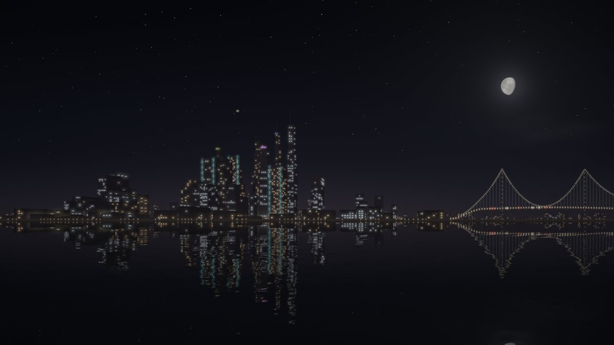

# Harbor Night — screensaver

Night-time harbour city: skyline with window lights switching on and off, a bridge
(cable-stayed / suspension / arch / none, either side), aircraft, waterfront traffic,
moon, stars, clouds, optional fog, and everything reflected in shimmering water.



Visual effect only for now — there is no idle detection or shell integration yet.

## Files

| File | |
|---|---|
| `harbor-night.ts` | The whole thing. Zero dependencies, WebGL2, framework-free. |
| `demo.html` | Self-contained build for previewing — open it and go fullscreen. Generated; see below. |

## Use

```ts
import { defineHarborNight } from './harbor-night';
defineHarborNight();                                   // registers <wash-screensaver-harbor>
document.body.append(document.createElement('wash-screensaver-harbor'));
```

The element is a fixed fullscreen overlay by default (`inline` attribute makes it a normal
block). Remove it to stop; it tears down its GL context on disconnect and pauses while the
tab is hidden.

**Space** toggles a control panel: brightness, clouds, fog, bridge type, bridge side,
re-randomize. Settings persist in `localStorage` (`wash.screensaver.harbor`). While mounted
it captures Space page-wide.

Attributes: `speed`, `seed`, `fps`, `brightness`, `clouds`, `fog` (0..1),
`bridge` (`auto|cable|suspension|arch|none`), `bridge-side` (`auto|left|right`).

Or drive a canvas directly:

```ts
const sn = new HarborNight(canvas, { fog: 0.3 }).start();
sn.set({ brightness: 0.6 }); sn.setBridge('arch', 'right'); sn.randomize();
```

## How it renders

All into one half-float offscreen target, then a composite pass:

1. **Sky** — one fullscreen shader: gradient + city light dome, stars, moon, fbm clouds.
2. **Planes** — instanced light sprites, simulated on the CPU (nav, strobe, beacon, landing).
3. **City** — per building group, back to front: silhouette (one-point perspective
   trapezoids), then its window lights. Window on/off state is evaluated in the vertex
   shader from a hash of `(seed, floor(t / period))`, so there is no per-frame CPU work.
   Waterfront road traffic is slotted in just before the front row so it shows only in gaps.
4. **Composite** — above the horizon the scene; below it the mirrored scene displaced by a
   perspective-correct, LOD-faded wave gradient, supersampled (6 taps) into shimmering light
   columns. Optional fog blooms lights via the mip chain. Then tonemap, vignette, dither.

Anything added to the light-sprite pass (fireworks, say) is reflected for free.

## Rebuilding `demo.html`

```sh
npx esbuild harbor-night.ts --bundle --format=iife --global-name=HN --minify --outfile=/tmp/hn.js
python3 - <<'EOF'
js = open('/tmp/hn.js').read()
open('demo.html', 'w').write(
  '<!doctype html><html><head><meta charset="utf-8"><meta name="viewport" content="width=device-width,initial-scale=1">'
  '<title>Harbor Night</title><style>html,body{margin:0;height:100%;background:#000}</style></head><body>'
  '<script>' + js + '</script><script>HN.defineHarborNight();'
  'document.body.append(document.createElement("wash-screensaver-harbor"));</script></body></html>')
EOF
```
