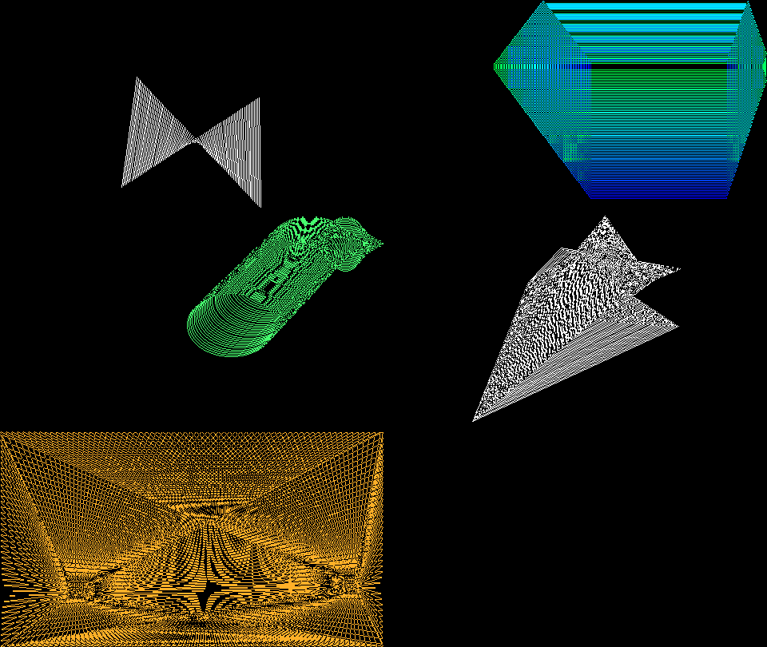

# Moiré Classic — screensaver

In the spirit of the classic Mac "Moiré" screensaver: repeating shapes drawn as hard
1-pixel XOR lines. The moiré is the genuine article, produced by the aliasing of closely
packed 1-px lines as on a 1-bit Mac.



Visual effect only. There is no idle detection or shell integration yet. For the modern
glowing version, see [`../screensaver-moire-glow`](../screensaver-moire-glow).

## Files

| File | |
|---|---|
| `moire-classic.ts` | The whole thing. Zero dependencies, Canvas2D, framework-free. |
| `demo.html` | Self-contained build for previewing. Open it and go fullscreen. |

## Use

```ts
import { defineMoireClassic } from './moire-classic';
defineMoireClassic();                                  // registers <wash-screensaver-moire-classic>
document.body.append(document.createElement('wash-screensaver-moire-classic'));
```

The element is a fixed fullscreen overlay by default; the `inline` attribute makes it a
normal block. It pauses while the tab is hidden.

**Space** toggles a control panel with shape (cycle or pin one), colour, pixel size,
brightness, trail, speed and re-randomize. Settings persist in `localStorage`
(`wash.screensaver.moire-classic`). While it's mounted it captures Space page-wide.

Attributes: `shape` (`auto|lines|rects|ovals|polygon|fan`),
`color` (`mono|rainbow|green|amber`), `brightness`, `trail`, `speed` (0..1),
`pixel` (1..4, default 2), `hold` (seconds per shape when cycling, default 30).

## How it renders

Shapes are rasterized by hand (Bresenham lines, midpoint ellipses) into a low-res
`Uint32Array` framebuffer with XOR, then blitted with `putImageData` and scaled up with
`image-rendering: pixelated`.

Trail modes keep a ring of the last N shapes. Each tick XOR-draws the new shape and
XOR-draws the oldest again, which erases it. There are no clears or redraws, and where
shapes overlap the pixels cancel, as QuickDraw's `patXor` did. Polygon edges skip their
last pixel so shared vertices aren't XORed twice. In Rainbow mode each new shape gets the
next hue, and overlapping colours XOR into new ones, as on colour QuickDraw.

Fan mode clears and redraws every frame: rays from two moving hubs to every k-th
border pixel.
