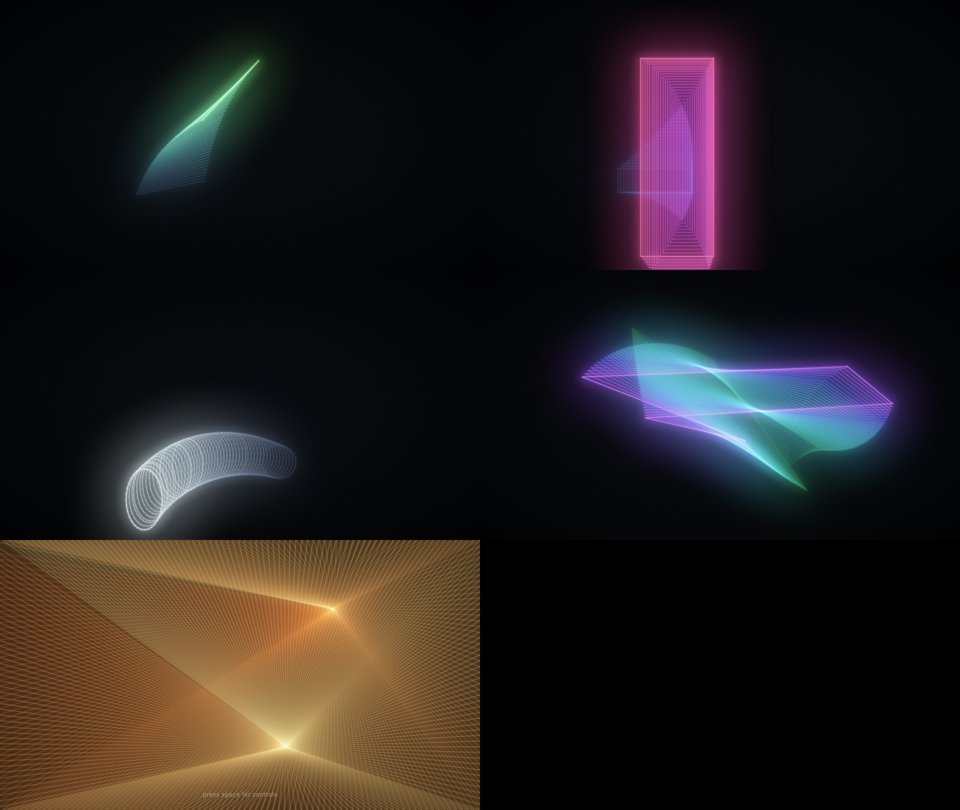

# Moiré Glow — screensaver

A modern take on the classic Mac "Moiré" screensaver: a bouncing figure that leaves a
trail of copies of itself, with moiré where the copies bunch up. It's drawn as
antialiased glowing light rather than 1-bit XOR lines.



Visual effect only. There is no idle detection or shell integration yet. For the
1-bit original, see [`../screensaver-moire-classic`](../screensaver-moire-classic).

## Files

| File | |
|---|---|
| `moire-glow.ts` | The whole thing. Zero dependencies, WebGL2, framework-free. |
| `demo.html` | Self-contained build for previewing. Open it and go fullscreen. |

## Use

```ts
import { defineMoireGlow } from './moire-glow';
defineMoireGlow();                                     // registers <wash-screensaver-moire-glow>
document.body.append(document.createElement('wash-screensaver-moire-glow'));
```

The element is a fixed fullscreen overlay by default; the `inline` attribute makes it a
normal block. Removing it tears down the GL context, and it pauses while the tab is hidden.

**Space** toggles a control panel with shape (cycle or pin one), palette, brightness,
glow, trail, speed and re-randomize. Settings persist in `localStorage`
(`wash.screensaver.moire-glow`). While it's mounted it captures Space page-wide.

Attributes: `shape` (`auto|lines|rects|ovals|polygon|fan`),
`palette` (`aurora|neon|ice|ember|mono`), `brightness`, `glow`, `trail`, `speed` (0..1),
`hold` (seconds per shape when cycling, default 35).

## How it renders

1. **Motion**: vertices fly along slowly curving paths and bounce off the edges. They
   are stepped at a fixed 60 Hz, and a new trail copy is laid down only after the
   figure has moved ~5.5 px, so trail lines are evenly spaced and stay distinct.
2. **Lines**: each copy is a polyline, and each segment is an instanced quad. Its fragment
   shader evaluates a capsule SDF (crisp core plus a soft halo). Segments are half-open
   (no end cap), so polyline joints aren't lit twice. The newest copy is brightest; older
   copies fade and shift hue with age.
3. **Accumulate**: segments are blended additively into a half-float target, so dense
   parts of the trail build into bright interference bands.
4. **Bloom**: two-level separable Gaussian blur at 1/4 and 1/16 resolution (~12 px and
   ~48 px), then tonemap, vignette and dither.

Fan mode draws rays from two moving hubs to evenly spaced points round the border each
frame. The aliasing of that many fine rays is what makes its moiré.
