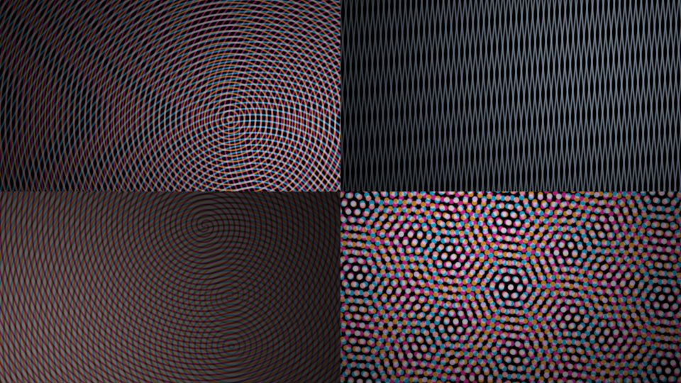

# Moiré Interference — screensaver

Slowly evolving interference patterns made by overlaying fine periodic layers: drifting
concentric rings, warped near-parallel gratings, counter-rotating spirals and rotated
halftone screens. It cross-fades to a new pattern with new parameters every 40 s.



*(Crops at 1:1. Scaling a moiré screenshot creates new aliasing, so the full-screen look
differs.)*

Visual effect only. There is no idle detection or shell integration yet.

## Files

| File | |
|---|---|
| `moire.ts` | The whole thing. Zero dependencies, WebGL2, one fullscreen fragment shader. |
| `demo.html` | Self-contained build for previewing. Open it and go fullscreen. |

## Use

```ts
import { defineMoire } from './moire';
defineMoire();                                         // registers <wash-screensaver-moire>
document.body.append(document.createElement('wash-screensaver-moire'));
```

The element is a fixed fullscreen overlay by default; the `inline` attribute makes it a
normal block. Removing it tears down the GL context, and it pauses while the tab is hidden.

**Space** toggles a control panel with pattern (cycle or pin one), palette, brightness,
density, speed and re-randomize. Settings persist in `localStorage`
(`wash.screensaver.moire`). While it's mounted it captures Space page-wide.

Attributes: `pattern` (`auto|rings|gratings|spirals|halftone`),
`palette` (`neon|gel|ink|glow`), `brightness`, `density`, `speed` (0..1),
`hold` (seconds per pattern, default 40), `fps`.

## How it renders

Moiré needs a non-linear combination of the layers. A plain sum of two gratings averages
to flat grey, and the low-frequency beat appears only when the layers multiply (overlaid
transparencies) or screen (overlaid light). So each pattern produces up to three coverage
layers, and the palette decides how they combine:

- **neon**: coloured light lines, screen-blended on black
- **gel**: coloured filter films multiplied over a dim light
- **ink**: black lines on dim paper light, the classic look
- **glow**: white light lines on black

Each layer is analytically antialiased with `fwidth()` and fades to its mean coverage as
its period approaches a pixel. The moiré you see is therefore the designed one, not
raster aliasing. Spirals take `fwidth` from two copies of the phase with opposite branch
cuts, so there's no seam along the `atan` discontinuity. A soft wandering light keeps the
field from looking uniformly flat.
